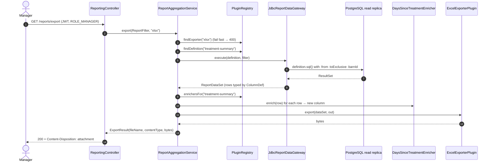
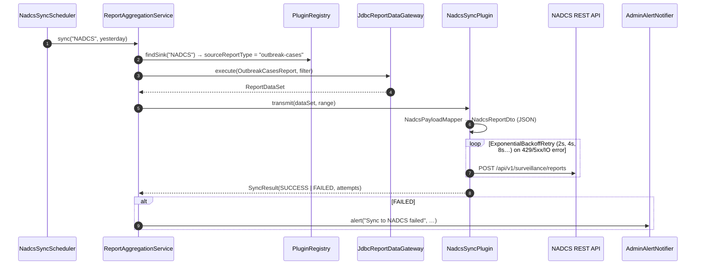
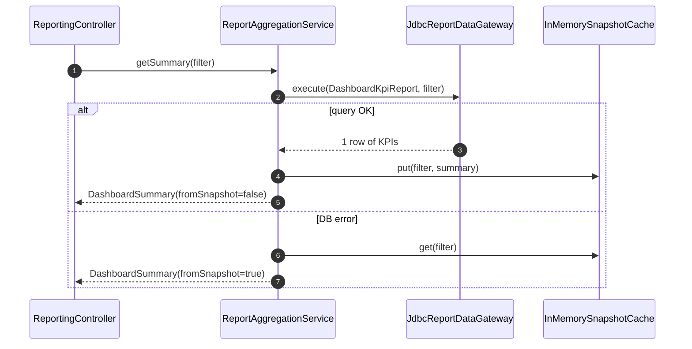

# VinaBeef — Reporting Subsystem (Microkernel)

Code layout for FR-11 (report export), FR-12 (NADCS sync) and FR-13 (dashboard),
matching the class diagram `reporting_class_diagram_v4.drawio`.

## 1. Modules and dependency rules

| Module | Role in the microkernel | May depend on |
|---|---|---|
| `reporting-kernel` | **Core**: facade, aggregation pipeline, plugin registry, SPI, model, ports | JDK only (no Spring) |
| `plugins/report-definitions` | **Plugins**: *what* data is in a report + derived columns | kernel |
| `plugins/exporter-excel`, `plugins/exporter-pdf` | **Plugins**: *how* a report is rendered | kernel + POI / OpenPDF |
| `plugins/integration-nadcs` | **Plugin**: *where* data is sent | kernel (JDK HttpClient) |
| `reporting-infrastructure` | **Adapters** for kernel ports: JDBC on read replica, cache, alerts | kernel |
| `reporting-app` | **Composition root**: Spring Boot, REST, security, scheduler | kernel, infrastructure; plugins at **runtime scope only** |

```
            reporting-app ──────────────┐ (runtime classpath only)
              │        │                ▼
              ▼        ▼            plugins/*  ──► reporting-kernel
  reporting-infrastructure ─────────────────────► reporting-kernel
```

* The kernel never imports a plugin or an adapter. Plugins never import each other.
* The app pulls plugins in with `<scope>runtime</scope>`, so app code *cannot* reference
  plugin classes; it only sees `ReportingFacade`.

## 2. Package layout

```
vinabeef-reporting/
├── db/
│   └── schema-v2.sql
├── plugins/
│   ├── exporter-excel/
│   │   ├── src/main/
│   │   │   ├── java/com/vinabeef/reporting/plugins/excel/
│   │   │   │   └── ExcelExporterPlugin.java
│   │   │   └── resources/META-INF/services/
│   │   │       └── com.vinabeef.reporting.kernel.spi.ReportExporterPlugin
│   │   └── pom.xml
│   ├── exporter-pdf/
│   │   ├── src/main/
│   │   │   ├── java/com/vinabeef/reporting/plugins/pdf/
│   │   │   │   └── PdfExporterPlugin.java
│   │   │   └── resources/META-INF/services/
│   │   │       └── com.vinabeef.reporting.kernel.spi.ReportExporterPlugin
│   │   └── pom.xml
│   ├── integration-nadcs/
│   │   ├── src/main/
│   │   │   ├── java/com/vinabeef/reporting/plugins/nadcs/
│   │   │   │   ├── ExponentialBackoffRetry.java
│   │   │   │   ├── NadcsApiClient.java
│   │   │   │   ├── NadcsPayloadMapper.java
│   │   │   │   ├── NadcsReportDto.java
│   │   │   │   └── NadcsSyncPlugin.java
│   │   │   └── resources/META-INF/services/
│   │   │       └── com.vinabeef.reporting.kernel.spi.IntegrationSinkPlugin
│   │   └── pom.xml
│   ├── report-definitions/
│   │   ├── src/main/
│   │   │   ├── java/com/vinabeef/reporting/plugins/definitions/
│   │   │   │   ├── AbstractSqlReportDefinition.java
│   │   │   │   ├── DashboardKpiReport.java
│   │   │   │   ├── DaysSinceTreatmentEnricher.java
│   │   │   │   ├── HerdByBarnReport.java
│   │   │   │   ├── OutbreakCasesReport.java
│   │   │   │   ├── PeriodLabelEnricher.java
│   │   │   │   ├── TreatmentSummaryReport.java
│   │   │   │   └── TreatmentTrendReport.java
│   │   │   └── resources/META-INF/services/
│   │   │       ├── com.vinabeef.reporting.kernel.spi.ColumnEnricher
│   │   │       └── com.vinabeef.reporting.kernel.spi.ReportDefinition
│   │   └── pom.xml
│   └── pom.xml
├── reporting-app/
│   ├── src/main/
│   │   ├── java/com/vinabeef/reporting/app/
│   │   │   ├── config/
│   │   │   │   ├── KernelConfig.java
│   │   │   │   └── SecurityConfig.java
│   │   │   ├── scheduler/
│   │   │   │   └── NadcsSyncScheduler.java
│   │   │   ├── web/
│   │   │   │   ├── ApiExceptionHandler.java
│   │   │   │   └── ReportingController.java
│   │   │   └── ReportingApplication.java
│   │   └── resources/
│   │       └── application.yml
│   └── pom.xml
├── reporting-infrastructure/
│   ├── src/main/java/com/vinabeef/reporting/infrastructure/
│   │   ├── alert/
│   │   │   └── LoggingAdminAlertNotifier.java
│   │   ├── cache/
│   │   │   └── InMemorySnapshotCache.java
│   │   ├── jdbc/
│   │   │   ├── JdbcReportDataGateway.java
│   │   │   └── NamedSql.java
│   │   └── package-info.java
│   └── pom.xml
├── reporting-kernel/
│   ├── src/
│   │   ├── main/java/com/vinabeef/reporting/kernel/
│   │   │   ├── api/
│   │   │   │   └── ReportingFacade.java
│   │   │   ├── core/
│   │   │   │   ├── PluginNotFoundException.java
│   │   │   │   ├── PluginRegistry.java
│   │   │   │   ├── ReportAggregationService.java
│   │   │   │   └── ReportGenerationException.java
│   │   │   ├── model/
│   │   │   │   ├── ColumnDef.java
│   │   │   │   ├── ColumnType.java
│   │   │   │   ├── DashboardSummary.java
│   │   │   │   ├── DateRange.java
│   │   │   │   ├── ExportResult.java
│   │   │   │   ├── Granularity.java
│   │   │   │   ├── ReportDataSet.java
│   │   │   │   ├── ReportFilter.java
│   │   │   │   ├── ReportPeriod.java
│   │   │   │   ├── Row.java
│   │   │   │   ├── SyncResult.java
│   │   │   │   └── SyncStatus.java
│   │   │   ├── port/
│   │   │   │   ├── AdminAlertNotifier.java
│   │   │   │   ├── DashboardSnapshotCache.java
│   │   │   │   └── ReportDataGateway.java
│   │   │   └── spi/
│   │   │       ├── ColumnEnricher.java
│   │   │       ├── IntegrationSinkPlugin.java
│   │   │       ├── Plugin.java
│   │   │       ├── PluginContext.java
│   │   │       ├── ReportDefinition.java
│   │   │       └── ReportExporterPlugin.java
│   │   └── test/java/com/vinabeef/reporting/kernel/
│   │       ├── core/
│   │       │   └── ReportAggregationServiceTest.java
│   │       └── model/
│   │           └── ReportPeriodTest.java
│   └── pom.xml
└── pom.xml
```

### Kernel packages

| Package | Contents | Why it exists |
|---|---|---|
| `kernel.api` | `ReportingFacade` | Single entry point for controllers and schedulers |
| `kernel.core` | `ReportAggregationService`, `PluginRegistry`, exceptions | The stable pipeline; lookup of plugins by String key |
| `kernel.spi` | `Plugin`, `PluginContext`, `ReportDefinition`, `ColumnEnricher`, `ReportExporterPlugin`, `IntegrationSinkPlugin` | Contracts that plugins implement (the extension points) |
| `kernel.model` | `ReportFilter`, `ReportDataSet`, `ColumnDef`, `ColumnType`, `Row`, `ExportResult`, `DashboardSummary`, `SyncResult`, `DateRange` | Data passed along the flow |
| `kernel.port` | `ReportDataGateway`, `DashboardSnapshotCache`, `AdminAlertNotifier` | What the kernel needs from the outside world |

## 3. How plugins are loaded

1. Each plugin JAR lists its classes in `META-INF/services/<SPI interface name>`.
2. `KernelConfig` calls `PluginRegistry.discover(classLoader, pluginContext)`.
3. The registry indexes plugins by key (`reportType`, `format`, `sinkId`), fails fast on duplicate
   keys or a sink whose `sourceReportType` does not exist, then calls `init(PluginContext)`.
4. Plugins read their settings from `reporting.plugins.*` in `application.yml` via `PluginContext`,
   so they stay free of Spring.

## 4. Interactions

### A. Export report (FR-11) — `GET /api/v1/reports/export?type=treatment-summary&format=xlsx&from=…&to=…`



### B. NADCS sync (FR-12) — daily at 01:00 or `POST /api/v1/integrations/NADCS/sync`



### C. Dashboard (FR-13) — `GET /api/v1/reports/summary`



## 5. Extending without touching the kernel (OCP)

| Change | What you do | Files touched |
|---|---|---|
| Report needs a field already in the DB | Add a `ColumnDef` + SQL column in that report | 1 class (see `TreatmentSummaryReport` → `breed`) |
| Derived field | New `ColumnEnricher` + 1 line in `META-INF/services` | 2 files (see `DaysSinceTreatmentEnricher`) |
| New report | New `ReportDefinition` + 1 services line | 2 files |
| Time breakdown in a report | `GROUP BY date_trunc(:bucket, … AT TIME ZONE 'Asia/Ho_Chi_Minh')` in its SQL (see `TreatmentTrendReport`) | 1 class |
| New format (CSV, DOCX) | New module implementing `ReportExporterPlugin` + add it to `reporting-app/pom.xml` | new module + 1 pom entry |
| New external system (VietGAP) | New module implementing `IntegrationSinkPlugin` (+ its own `ReportDefinition` if needed) | new module + 1 pom entry |

Never needed for any of the above: `ReportAggregationService`, `PluginRegistry`, `JdbcReportDataGateway`,
`ReportingController`, existing exporters.

## 6. Timeframes (periods and granularity)

Every report takes a time range plus an optional time bucket:

| Parameter | Values | Meaning |
|---|---|---|
| `period` | `2026`, `2026-H1`, `2026-Q2`, `2026-03`, `2026-W05`, `2026-03-15` | Named period → inclusive date range (`ReportPeriod.parse`) |
| `from`, `to` | ISO dates | Explicit range, used when `period` is absent |
| `granularity` | `DAY`, `WEEK`, `MONTH`, `QUARTER`, `YEAR` | One row per bucket for reports that group by time; default `MONTH` |

```
GET /api/v1/reports/export?type=treatment-trend&period=2026&granularity=QUARTER&format=xlsx
→ one row per quarter and barn, with a "2026-Q1" label added by PeriodLabelEnricher
```

* Day, month and quarter boundaries are cut in farm local time (Asia/Ho_Chi_Minh): a treatment at
  23:30 on 31 March counts in Q1.
* Quarters follow the calendar year. For a fiscal year change only `ReportPeriod.quarter()`.
* Reports that do not group by time simply ignore `granularity`.

## 7. Database

`db/schema-v2.sql` is the cleaned shared-database schema the report SQL is written against
(schemas `barn_gate`, `cattle_tag`, `movement`, `health`, `reporting`, `security`). It was loaded into
PostgreSQL 16 and every `ReportDefinition` query was run against sample data.

## 8. Build and run

```bash
mvn clean verify                       # builds all modules, runs kernel tests
DB_REPLICA_HOST=… NADCS_API_KEY=… \
  mvn -pl reporting-app spring-boot:run
```

### Run locally (dummy Postgres in Docker)

```bash
docker compose up -d --wait                      # Postgres 16: db/schema-v2.sql + grants + seed data (docker/postgres/)
mvn clean install
mvn -pl reporting-app spring-boot:run -Dspring-boot.run.profiles=local

TOKEN=$(scripts/dev-token.sh MANAGER)            # or ADMIN for /integrations/NADCS/sync
curl -H "Authorization: Bearer $TOKEN" "localhost:8080/api/v1/reports/summary?period=2026-11"
curl -H "Authorization: Bearer $TOKEN" -OJ "localhost:8080/api/v1/reports/export?type=treatment-trend&period=2026&granularity=QUARTER&format=xlsx"
```

API docs (springdoc): Swagger UI at http://localhost:8080/swagger-ui.html, OpenAPI JSON at `/v3/api-docs`.
Click **Authorize** and paste the output of `scripts/dev-token.sh MANAGER` (or `ADMIN`). Docs are on in the `local`
profile and off by default elsewhere; enable them with `API_DOCS_ENABLED=true`.

The `local` profile (`application-local.yml` + `LocalJwtConfig`) swaps the issuer-based JWT check for an
HS256 dev secret and points NADCS at an unused port, so a sync fails and raises the admin alert.
`docker compose down -v` resets the data (init scripts only run on an empty volume).

Notes
* `spring.datasource` must point at the **read replica** with a read-only DB user.
* Put `NotoSans-Regular.ttf` and `NotoSans-Bold.ttf` in `plugins/exporter-pdf/src/main/resources/fonts/` for Vietnamese text in PDFs
  (or set `reporting.plugins.pdf.font` / `pdf.font-bold` to TTF paths; the `local` profile uses macOS Arial).
* `InMemorySnapshotCache` is per pod; use a Redis adapter if you scale to several pods.
